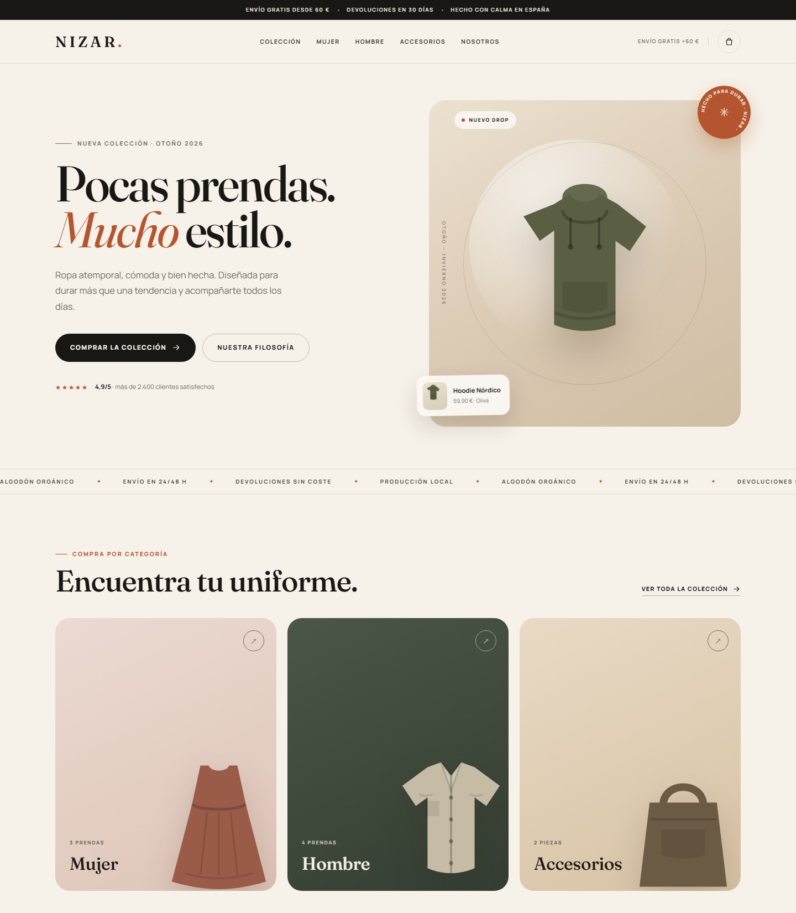

# NIZAR — Tienda de ropa

Tienda e-commerce de demostración construida con **Flask + HTML, CSS y JavaScript vanilla**. Sin frameworks de frontend, sin base de datos y sin dependencias más allá de Flask.



## Funcionalidades

- Catálogo de 9 prendas con ilustraciones SVG locales.
- Filtros por categoría y búsqueda en vivo.
- Favoritos persistentes en `localStorage`.
- Carrito lateral persistente, con control de cantidades y cálculo de envío.
- Checkout con validación en cliente y en servidor.
- Pedidos guardados en `data/orders.json` (excluido del repositorio).
- Notificaciones, modal de producto y menú responsive.
- Diseño adaptable a escritorio, tablet y móvil.

## Requisitos

- Python 3.10 o superior.
- Flask 3 (se instala desde `requirements.txt`).

## Ejecutar en local

### Windows

Doble clic en `iniciar_tienda.bat`. El script crea el entorno virtual si hace falta, instala dependencias y abre `http://127.0.0.1:5000`.

### macOS / Linux

```bash
python -m venv .venv
source .venv/bin/activate
pip install -r requirements.txt
python app.py
```

Después abre `http://127.0.0.1:5000` en el navegador.

## Estructura

```
tienda-ropa/
├── app.py                 # Backend Flask y API de checkout
├── requirements.txt
├── iniciar_tienda.bat     # Lanzador para Windows
├── data/                  # Pedidos locales (orders.json no se versiona)
├── templates/
│   └── index.html         # Frontend y sprites SVG
└── static/
    ├── css/styles.css
    ├── js/app.js
    └── img/favicon.svg
```

## API

| Método | Ruta             | Descripción                                  |
|--------|------------------|----------------------------------------------|
| GET    | `/`              | Página de la tienda                          |
| GET    | `/api/products`  | Catálogo en JSON                             |
| POST   | `/api/checkout`  | Valida el pedido y lo guarda en `orders.json` |

## Notas

- El pago es **simulado**: no se procesan tarjetas ni cobros reales.
- Los pedidos se acumulan en `data/orders.json`, que está en `.gitignore` para no subir datos de clientes.
- Para producción, ejecuta con `debug=False`, un servidor WSGI (Waitress/Gunicorn) y configura HTTPS.

## Publicar en GitHub

```bash
git init
git add .
git commit -m "Tienda NIZAR con Flask"
git branch -M main
git remote add origin <URL_DEL_REPOSITORIO>
git push -u origin main
```

El archivo `.gitignore` ya excluye el entorno virtual, cachés de Python y los pedidos locales.
